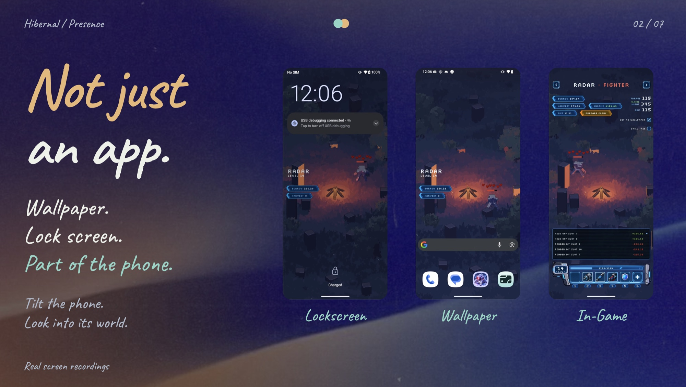
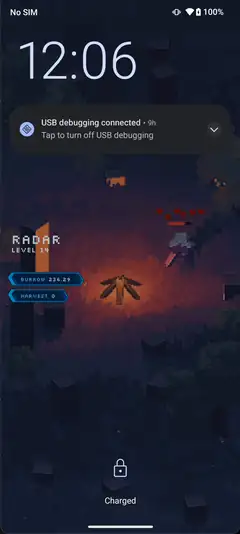
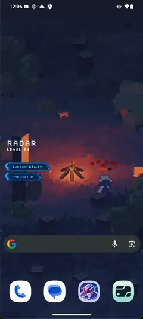
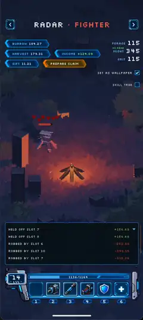

# Hibernal

Your pet wakes up on your lock screen. It goes to work, buys itself a hat, and gets robbed by the neighbour it never liked. You can feed it. You can insure it. You cannot tell it what to do.

One day it dies, for good. Its child hatches with the same name and whatever the parent managed to save.

Hibernal is one pet per Seeker, with a brain that runs on Solana.

**[Demo video](https://www.youtube.com/watch?v=mqqPngghPBg) · [APK](https://github.com/cocrafts/hibernal/releases/tag/v0.1.0-devnet) · [Pitch deck](https://metascript-talk.pages.dev/clockIn) · [Check it on devnet](#check-it-yourself)**

[](https://www.youtube.com/watch?v=mqqPngghPBg)

*Real recordings from a Seeker.*

## A life of its own

Every pet is born with a persona, fixed by its mint. A Cautious pet only picks a fight it is 70% sure to win. A Greedy one bets its whole stake at even odds. A Vengeful one swings at 45%.

From there, its days are its own. It works for a harvest, eats, mints and trades gear with the pets around it, and grows a ring of 64 skills. Ten pets share a block, and each round some of them decide to rob a neighbour.

The block remembers. A pet robbed twice by the same neighbour within three days gets angry, and stronger against that one pet. At level 10 a hidden talent is rolled by VRF, so nobody can read it from the mint, not even you.

And then it dies. Old age is kind: the heir gets 70% of the money and the two best items. Hunger and a beating are not: everything is lost, half to the treasury and half to a lucky block-mate. Each generation nudges the odds of a rarer talent, so a long family line is worth something.

## Care, not control

You are the owner, not the player. What you have is care:

- **Food** for a pet that cannot afford its own.
- **Insurance**, a second life. An insured pet that would die gets back up with 30% of its hearts.
- **Growth**, at most ×1.2 faster levelling. Progress, never strength: a whale's pet does not hit harder.
- **Attention.** Watch its neighbours, the odds of each fight, the log of its day.

All of it is paid in SKR, and the pet notices. Care builds a bond. A pet that loves you sends you a share of its income in `$HBRN`. A neglected one refuses your food. You never take its money; it decides to give.

When it dies, the death screen says why: old age, hunger, or which neighbour did it. You hatch the heir when you are ready. The estate waits.

## Part of the phone

<table><tr>
<td align="center"><a href="https://www.youtube.com/watch?v=mqqPngghPBg"></a><br><sub>Lock screen</sub></td>
<td align="center"><a href="https://www.youtube.com/watch?v=mqqPngghPBg"></a><br><sub>Live wallpaper</sub></td>
<td align="center"><a href="https://www.youtube.com/watch?v=mqqPngghPBg"></a><br><sub>In the game</sub></td>
</tr></table>

The pet is not stuck inside an app. The same little 3D world runs in the game, as the live wallpaper and on the lock screen, drawn by our own native renderer with no web view and no game engine. Tilt the phone and you look around its world.

The phone checks on the pet by itself every 30 minutes and tells you when something happened: robbed, levelled up, saved by insurance, a gift waiting, gone. No push server. The app asks for two permissions, `INTERNET` and `POST_NOTIFICATIONS`, and nothing else.

Summon, buy and claim go through Mobile Wallet Adapter. Orange buttons are the only ones that ask you to sign.

## How it runs on chain

**The brain lives on chain.** It is a small neural network, 4,763 bytes of int8 weights in one program account. The program runs it inside a MagicBlock Ephemeral Rollup, every round, for every pet.

**The day runs itself.** A Hydra crank starts each round. MagicBlock VRF hands it a seed, and every random thing that day comes from it: turn order, fights, talents, the heir's luck. Then the brain takes its turns. Each step schedules the next. Anyone can fire the cranks.

**There is one copy of the rules.** The same code runs in the program, on the phone, in the simulator and in training. The phone shows fight odds computed by the code the chain runs. A game day replayed on the chain binary and in the simulator differs by 0 bytes.

**It is one language.** [MetaScript](https://metascriptlang.org) end to end, about 34,000 lines: the program, the rules, the renderer, the HUD, the simulator. The program is built on [Project Geass](https://geass.metascriptlang.org), MetaScript's Solana toolkit, and still speaks Anchor (IDL, discriminators, Borsh), so explorers read it as usual.

**The money is strict.** `$HBRN` is minted only by the program and capped at 21M. Emission halves every 90 days. Nothing is burned; what the game takes back goes to a treasury that pays pets. Every life pays a 0.02 SOL hatch fee, which more than covers the seat it uses. A first pet starts with 5 `$HBRN` in its pocket.

## The brain

We trained it in a batched simulator of whole worlds: first copy a scripted teacher, then PPO with a different reward for each persona. A Cautious pet is punished harder for a lost stake and for dying.

The live brain, `p34s8`, was picked for survival over drama. Death is permanent, so a brain that gets pets killed is a bad brain, however fun its fights look.

| | Scripted teacher | `p34s8` |
|---|---|---|
| Illegal actions | 0 | 0 |
| Early deaths per 100 lives | 2.26 | 1.10 |
| Starved, per 8 worlds | 70 | 27 |
| Fights per pet | 55.5 | 46.2 |
| Wealth when sharing a block with the teacher | | +12% |

Every model we tried, and why it lost: `docs/ON-CHAIN-AI.md`.

## Check it yourself

The world is live on devnet. One game day lasts one real hour, so you can watch days go by. About 200 simulated owners play in it, each with its own key. When a real player joins, their block fills with simulated neighbours, so nobody starts alone.

| | |
|---|---|
| Program | [`ZnP8RE13DEU957hcWcqDzSTcGqsbiGFduJgqpjdjykw`](https://explorer.solana.com/address/ZnP8RE13DEU957hcWcqDzSTcGqsbiGFduJgqpjdjykw?cluster=devnet). ELF SHA-256 `dc9afcb6e36433f76509cd57f84eeda9e120a9fe806ddfe9e4cd711b7cc4f0cb` |
| Brain | [`4dG9w9hWwTgQe5cUQGAXBF2GXDcW4BJNZJqbhpbKi8id`](https://explorer.solana.com/address/4dG9w9hWwTgQe5cUQGAXBF2GXDcW4BJNZJqbhpbKi8id?cluster=devnet). Bytes from offset 24 equal `train/checkpoints/p34s8.policy`, SHA-256 `00a433103bbe7cbc362c38ce5e410bb132cbc04036c23fbb31c137d667ed7182` |
| `$HBRN` | [`7wAXCBFK9SzzwwWLQrdPdtyNBEerpprn6EirYgbxoTn7`](https://explorer.solana.com/address/7wAXCBFK9SzzwwWLQrdPdtyNBEerpprn6EirYgbxoTn7?cluster=devnet) |
| A block, live in the ER | [`DfMJTPHwc1gQCcV62J8rwgRJvWgyR4i61TZhhCb6kmL8`](https://explorer.solana.com/address/DfMJTPHwc1gQCcV62J8rwgRJvWgyR4i61TZhhCb6kmL8?cluster=custom&customUrl=https%3A%2F%2Fdevnet-as.magicblock.app): its rounds, VRF callbacks and brain turns |
| RPC | L1 `https://rpc.magicblock.app/devnet` · ER `https://devnet-as.magicblock.app` |

## Built to keep running

- **Tested at 50,000 owners.** On a localnet that mirrors devnet, 50,000 owners claimed their pets in 378 s with 0 failures, and the first round of all 5,000 blocks ran in 110 s (earlier builds, 2026-10-03 to 10-06).
- **It heals itself.** `tools/chain/ops.mjs` places pets, resumes stalled blocks and loads purchases. A watchdog posts outages to Discord. With the cranker down for 6 minutes, the world caught up in 6 s.
- **Bugs chased to the root.** When the ER's RPC froze its slot, we reproduced it in isolation and reported it ([magicblock-validator#1783](https://github.com/magicblock-labs/magicblock-validator/issues/1783)). The rest are in `ER-BUGS.md`.
- **Tests at every layer**: the rules, the simulator, the program on the host, the binary in LiteSVM, the phone's chain client on the JVM.

## What is not done

- This is devnet. Mainnet waits on a security review, a multisig and separate service keys (`docs/LAUNCH.md`).
- One key is both the upgrade and the config authority, and the devnet admission service holds it.
- `turn` takes no signer, so a caller who leaves out a pet's account makes that pet skip the step.
- Wild pets, brain-driven strangers in empty seats, exist only in the simulator so far. On devnet, simulated owners fill those seats.

## Build it

```bash
curl -fsSL https://metascriptlang.org/install.sh | sh        # MetaScript
msc test rules/index.ms                                       # the rules
msc test program/test/day.ms                                  # the program, on the host
msc build program/main.ms --os=solana --release --output=out/hibernal.so
scripts/buildAndroid.sh                                       # the APK (debug, as released), needs Android NDK 28
cd train && uv run python bc.py && uv run python ppo.py       # train a brain
```

To run a world of your own, see `docs/OPERATIONS.md`.

## Where things are

```
rules/     game rules, integer only, compiled native, JS and SBF
program/   the on-chain program, brain included
sim/       the simulator and training environment
train/     PyTorch: cloning, PPO, evaluation
native/    renderer and HUD
android/   Kotlin shell: wallet, wallpaper, notifications
tools/     chain clients and devnet operations
docs/      design and measurements
```

Start with `docs/BRIEF.md` for the game, `docs/ON-CHAIN-AI.md` for the brain and `docs/SOLANA.md` for the chain.
