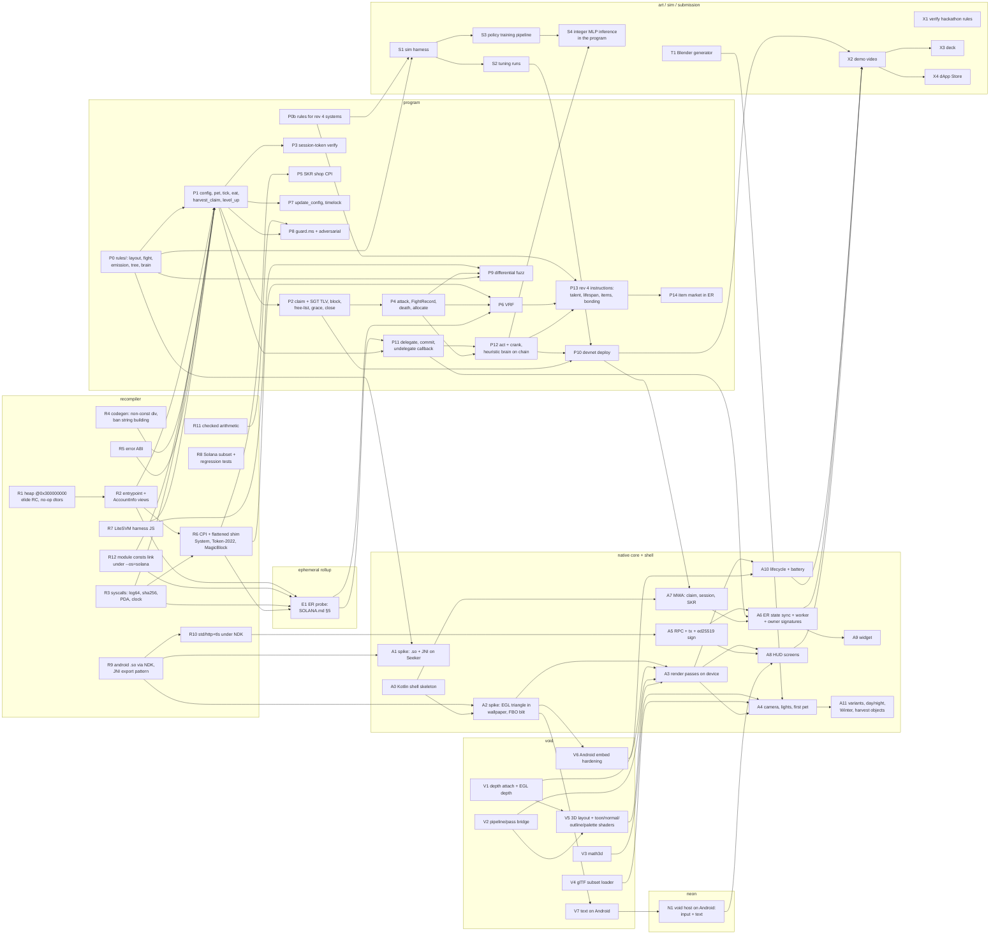

# ROADMAP — Hibernal, all-in MetaScript (D31)

> Companion to `BRIEF.md` (game + architecture) and `RENDERER-BRIEF.md` (renderer + Android surfaces). This file answers three questions: **what can start today**, **what is blocked and on which repo**, and **what unblocks what**, so work can be split across people and across the three repos (`hibernal`, `recompiler`, `void`, plus `neon`).
>
> Status legend: **READY** = no upstream blocker, start now · **BLOCKED:R / V / N** = waiting on recompiler / void / neon work · **BLOCKED:dep** = waiting on another package in this file · **OPT** = optional, cut first.
> Estimates are person-days for someone who knows the stack. Last updated 2026-09-14 (BRIEF rev 4: brain on chain in the MagicBlock ER, VRF, lifespan, talent, items, bonding, wild pets).

---

## 1. The unproven toolchains (read first)

Everything sits on paths that have never run end to end. They are deliberately spiked separately on day 1 so a failure points at exactly one thing.

| Path | Evidence today | What "proven" means |
|---|---|---|
| `msc build --os=solana` | sBPF ELF builds and runs in LiteSVM (`talks/solana-meetup/demo`, 108 CU hello). No entrypoint parsing, no heap on the Solana heap region. | A program reads two accounts, mutates one, returns an error code, in LiteSVM. (**R1 + R2**) |
| `msc build --os=android --app=lib` | Target exists in the compiler; **never executed**. No NDK detection, no JNI. | `libhibernal.so` loads on the Seeker and Kotlin calls `fight()` through JNI. (**R9 + A1**) |
| MetaScript on the MagicBlock ER | Probe plan in `SOLANA.md` §5 (Rust control counter first). Delegation, VRF and crank are CPIs with no MetaScript SDK. | A MetaScript program signs as a PDA, delegates, runs `fight()` inside `act` in the ER, commits and undelegates. (**R2 + R12 + R3 + R6 + E1**); failing step 3 or 4 triggers the Rust-shell fallback (`SOLANA.md` §6) |

Tripwires: **day 1** both spikes; **day 4** `tick + eat + level_up` in LiteSVM (P1). A missed tripwire buys exactly one dated C shim for the blocking item (BRIEF D31), nothing else changes.

---

## 2. Dependency graph

**Critical path (chain):** R2 + R12 → R3 → R6 → E1 → P1 → P11 → P4 + P6 → P12 → P13 → P10 → X2.
**Critical path (device):** R9 → A2 → A3 → A4 → A10 → X2.
They merge only at the demo. Nothing on the device path waits on the program until A6/A7. The AI lane (P0b → S1 → S3 → S4) runs beside the chain lane; the heuristic brain in P12 ships without it.

---

## 3. Work packages

### 3.1 READY today (no upstream blocker)
| ID | Package | Est. | Notes |
|---|---|---|---|
| ~~**P0**~~ | `rules/`: `units.ms`, `stats.ms`, `layout.ms`, `rng.ms`, `fight.ms`, `emission.ms`, `tree.ms`, `brain.ms`, `winOdds.ms` | 3 | **Done 2026-09-12** (first pass), **combat rev 5 on 2026-09-13**: 36 rules tests (328 total) green under `msc test rules/index.ms`; `sim/determinism.ms` gives identical digests on native and js; `sim/curve.ms` meets §6.7. Not yet on chain: see R12. Feeds P1, A1, S1, P9. |
| **P0b** | `rules/` for BRIEF rev 4: XP leveling, 48-node ring tree, decline + natural death + heir package, talent, `work_power²` + 500-slot floor + wild-pet formulas, stat-driven loot, item math (mint roll, wear, buyback), bonding + gifts, social effects; tests and sim hooks for each | 4–6 | READY. Numbers still open are `GAME-DESIGN.md` §17. Feeds S1, P13. |
| **S1** | Sim harness in MetaScript on `rules/`: 200 pets, 20 blocks, 120 epochs, invariants §6; models talent, lineage, `work_power²`, wild pets, item purchases and bonding; it is the policy training environment | 3 | Unblocked for rev 5 rules; rev 4 systems land with P0b. `sim/curve.ms` and `sim/determinism.ms` are the seed. |
| **A0** | Kotlin shell skeleton: gradle, `WallpaperService`, Activity + SurfaceView, `System.loadLibrary`, JNI stubs | 1 | Pure Kotlin. |
| **T1** | Blender parametric generator → glTF (positions, normals, vertex colors), 3 region variants, 9 animations as baked keyframes | 3 | Offline. Feeds A4. |
| **R7** | Extend the demo's LiteSVM JS harness: multi-account setup, clock control, state dump, seed replay | 1 | Feeds P1 and P9. |
| **R4** | Codegen: division/modulo by non-constant; ban string building under `--os=solana` | 1–2 | Compiler. |
| **R5** | Error ABI: `u64` return, `panic` → log + abort, `ProgramError` | 0.5 | Compiler. |
| **R11** | Verify u64 overflow behavior on the C backend; add `checked_*` ops if it wraps | 1 | Compiler; security prerequisite for P8. |
| **V3** | `std/math3d`: vec3, mat4 (ortho, lookAt, normal matrix), quat | 1 | Pure MetaScript. |
| **V4** | glTF subset loader (~200 lines) | 1 | Pure MetaScript + file IO. |
| **X1** | Verify CLOCK IN eligibility, submission rules, tracks and sponsor list in a browser | 0.2 | — |

### 3.2 BLOCKED on recompiler (R)
| ID | Package | Est. | Blocks |
|---|---|---|---|
| **R1** | Solana heap: arena at `0x300000000`, `.bss/.data` handling, RC ops elided under `--gc=manual`, no-op destructors | 2 | R2, everything in P |
| **R2** | Entrypoint: parse input into typed `AccountInfo` views (`std/solana/entrypoint.ms`); C SDK `sol_deserialize` is the reference | 2 | P1, R6 |
| **R3** | Syscalls: `sol_log_64_`, `sol_sha256`, `sol_create_program_address`, `sol_try_find_program_address`, `sol_get_clock_sysvar` | 1 | P1, R6, E1 |
| **R6** | CPI: `sol_invoke_signed_c` behind a flattened shim; helpers for System `create_account`, Token-2022 `transfer_checked`, MagicBlock delegation / magic / VRF programs | 2–3 | **critical path:** E1, P5, P6, P11, P12 |
| **R8** | Solana subset definition + one `--os=solana` regression test per construct | ongoing | P8 |
| **R9** | Android: NDK toolchain wiring (`--cc` wrapper or detection), `arm64-v8a`, `--app=lib` → `.so`, JNI export pattern (C shim with `JNIEXPORT` calling MetaScript symbols) | 1–3 | A1, A2, R10 |
| **R10** | `std/http` + `std/tls` link and run under NDK | 0.5–2 | A5 (fallback: OkHttp in the shell) |
| **R12** | Module-scope data under `--os=solana` becomes a C global that the contract link discards (`ld.lld: relocation refers to a symbol in a discarded section`). Measured 2026-09-12: a scalar `const` in the entry file folds and links; any `const` in a non-entry module (even used only in that file), any non-scalar `const` (string, struct) and any module-scope `let` fail; `enum` members and local `const`s are fine. Fold cross-module scalar consts or emit `static const`. Repro: `tools/rulesProbe.ms` (rules/ imports consts across files). | 0.5–1 | P1 (rules/ on chain), A1 |
| **R13** | Runtime calls that abort on chain, measured 2026-09-12 in LiteSVM: `String(uint64)` → `exceeded max BPF to BPF call depth`; `process.exit()` → `ProgramFailedToComplete`. Refuse them at compile time under `--os=solana` (extends R4/R5). | 0.5 | R8 |

### 3.2b Ephemeral Rollup probe (E)
| ID | Package | Est. | Depends on |
|---|---|---|---|
| **E1** | `SOLANA.md` §5 in six steps: Rust control counter on devnet (READY) → MetaScript account read/write → PDA-signed CPI (decisive) → MetaScript delegation cycle → `fight()` inside `act` with CU → VRF and crank. Records the §7 unknowns. | 3–5 | step 1 none; then R2, R12, R3, R6 |

### 3.3 BLOCKED on void (V)
| ID | Package | Est. | Blocks |
|---|---|---|---|
| **V1** | `EGL_DEPTH_SIZE 24` in `bridgeAndroid.c`, depth attachments on offscreen passes | 1 | V5, A3 |
| **V2** | Pipeline/pass creation reachable from MetaScript (flattened-descriptor bridge) or the fixed set of 4 pipelines in C | 1–2 | V5, A3 |
| **V5** | 3D vertex layout (pos, normal, color), color+depth pass, normal pass, outline pass, palette-LUT pass, nearest blit; sokol-shdc sources | 2–3 | A3 |
| **V6** | Android embed hardening: context loss, preview + live concurrently, visibility stop, no allocation in frame | 1–2 | A10 |
| **V7** | Text batcher verified on Android GLES3 | 0.5 | N1 |

### 3.4 BLOCKED on neon (N)
| ID | Package | Est. | Blocks |
|---|---|---|---|
| **N1** | Neon void host on Android: touch input routing, text, layout at 360×800 | 2 | A8. **Fallback:** draw the HUD imperatively with void 2D calls; Neon later. |

### 3.5 Program packages (BLOCKED:dep on R1–R5 unless noted)
| ID | Package | Est. | Depends on |
|---|---|---|---|
| **P1** | `init_config`, `GlobalConfig`, `Pet`, `tick` (accumulator + hunger + auto-eat), `eat`, `harvest_claim`, `level_up` | 3 | R1 R2 R3 R4 R5 R7 P0 |
| **P2** | `claim` (SGT TLV parse, DevAdmission on devnet), `Block`, free-list, grace, `close_dead_pet` | 3 | P1 |
| **P3** | Session-token verification (MagicBlock PDA layout) | 0.5 | P1 |
| **P4** | `attack` + `FightPending`, `fight()` in program, stat-driven loot, `FightRecord` ring buffer, starvation death + inheritance, `allocate` | 3 | P2 P0 |
| **P5** | SKR shop: `feed`, `buy_growth`, `buy_insurance`, `buy_skin` via Token-2022 CPI | 1 | R6 P1 |
| **P6** | VRF inside the ER: request CPI + `consume_fight` callback (VRF identity check); reused by `consume_talent` | 1.5 | R6 P4 E1 |
| **P7** | `update_config`, timelock authority | 0.5 | P1 |
| **P8** | `guard.ms` + adversarial LiteSVM tests (wrong owner, missing signer, fake session token, duplicate accounts, overflow inputs, shield, caps) | 2 | P1 R11 |
| **P9** | Differential fuzz: JS model vs LiteSVM `.so`, invariants, UBSan host build | 2 | P4 P0 R7 |
| **P11** | Delegation: `delegate_pet` / `delegate_block` / `delegate_config`, `commit`, commit-and-undelegate, `undelegate` callback | 2 | R6 E1 P1 |
| **P12** | `schedule_act` (crank) + `act(pet)` running the heuristic brain on chain with an odds table | 2 | P11 P4 P0 |
| **P13** | Rev 4 instructions: XP-gated `level_up`, natural death + heir, `consume_talent`, `mint_item` / `equip` / `sell_item`, `feed` / `talk` bonding and the gift ledger, fights against wild pets | 4 | P0b P6 P12 |
| **P14** | Item market in the ER: `list_item`, `buy_item`, `cancel_listing`, fee | 2 | P13 · built last |
| **P10** | Devnet deploy, DevAdmission group, demo config (`EPOCH_SECONDS=600`, `max_hearts=3`) | 0.5 | P2 S2 |

### 3.6 Native core + shell packages
| ID | Package | Est. | Depends on |
|---|---|---|---|
| **A1** | Spike: `libhibernal.so` via NDK, JNI calls `fight()` from Kotlin on the Seeker | 1 | R9 P0 |
| **A2** | Spike: EGL triangle into 360×800 FBO, nearest blit, inside `WallpaperService`; survives lock/unlock/picker | 1 | R9 A0 |
| **A3** | Render passes on device (color+depth, normal, outline, palette, blit) | 2 | A2 V1 V2 V5 |
| **A4** | Orthographic snapped camera, directional + campfire point light, toon ramp, first pet from T1, idle animation, touch | 2 | A3 V3 V4 T1 |
| **A5** | `native/rpc`: JSON-RPC, base58/base64, blockhash, legacy+v0 message serialization, ed25519 signing, `sendTransaction` (test against devnet memo/transfer before P10) | 2 | R9 R10 |
| **A6** | `hib_sync`: read pet and block from the ER, state cache for wallpaper and widget, owner-signature requests (claim, SKR) to MWA; optional session key for owner-driven play | 1.5 | A5 P11 A7 |
| **A7** | MWA `clientlib-ktx`: connect, claim signing, `create_session` (built natively, owner-signed), SKR purchases | 1.5 | A0 P10 |
| **A8** | HUD: campfire home + neighbor fires + Monte-Carlo odds, My Pet, Tree, Replay, Shop, Digest, Settings; talent reveal, items, bonding and talk, lineage | 4 | A3 A5 N1 (or fallback) |
| **A9** | Glance widget: hearts, harvest, Winter countdown, owner-signed emergency Claim | 1 | A6 · **OPT** |
| **A10** | Lifecycle hardening + battery measurement (Battery Historian, < 2%/h) | 1.5 | A3 V6 |
| **A11** | Variants, day/night palette, Winter snow, harvest objects, Fading desaturation | 2 | A4 |

### 3.7 Tuning and submission
| ID | Package | Est. | Depends on |
|---|---|---|---|
| **S2** | Automated tuner on S1: run variants of constants and curves (food cost, loot, combat, XP amounts, talent grades, item bonuses, bonding and gift caps, bot weight), score each run against BRIEF §6 invariants, search toward the targets (hill-climb as for combat rev 5), report the chosen numbers | 3 | S1 |
| **S3** | Policy training: native `rules/` binding, behavior cloning of `rules/brain.ms`, PPO in S1, fictitious self-play; distill to int8 MLPs (tree, economy, fight, social) | 5 | S1 |
| **S4** | Integer MLP inference in the program: weights read zero-copy from the `policy` account, CU measured in the ER, swapped in behind the heuristic interface | 1.5 | S3 P12 |
| **X2** | Demo video: unlock → pet on lock screen → claim → pet acts through the crank → works → eats → levels → talent reveal → fight replay → neighbor starves → inheritance | 1 | A6 A8 A10 P10 |
| **X3** | Deck (BRIEF §9 outline) | 1 | X2 |
| **X4** | dApp Store submission, README, architecture doc, pinned commits | 1 | X2 |

---

## 4. Suggested split

**Two people:**
- **Chain lane:** R2 + R12 → R3 → R6 → E1 → P1 → P2/P3 → P4 → P6 → P11 → P12 → P8/P9 → P5 → P13 → P10 → P7 → P14. Pulls R7 and P0b/S1/S2 in the gaps.
- **Device lane:** A0 → R9 → A1/A2 → V1/V2 → V5 → A3 → V3/V4/T1 → A4 → A5 (R10) → A7 → A6 → A8 (V7/N1) → A10 → A11 → A9.

**Solo:** P0 + A0 + T1 (all READY) on day 0 while thinking; then chain lane through P2 (days 1–5, it gates the demo), then device lane through A6 (days 6–11), then A8/A10 in buffer week 1, polish in buffer week 2. Cut order: P14 → A9 → A11 → A8 polish; S3/S4 fall back to the heuristic brain. Never A2/A10 (the wallpaper is the opener).

**Third person / spare hours:** P0b, S1, S3, T1, R7, V3, V4, X1 and E1 step 1 are all independent and unblock the most.

---

## 5. Milestones and tripwires

| When | Milestone | Proves |
|---|---|---|
| Day 1 | A1 green on Seeker; A2 green; R2 counter in LiteSVM; E1 step 1 Rust counter through the ER | The toolchains exist |
| Day 4 | P1 in LiteSVM from MetaScript; E1 step 3 PDA-signed CPI | Program path is real; MetaScript vs Rust shell decided (`SOLANA.md` §6) |
| Day 6 | A5 sends a signed tx to devnet from native | Client path is real |
| Day 8 | P10 devnet deploy; A4 first pet lit by a fire | Halfway demo |
| Day 11 | `act` runs from the ER crank on devnet and fights resolve by VRF | The pitch works |
| Day 13 | X2 recorded | Ship |
| Buffer wk 1 | Shims replaced by compiler fixes; P9 fuzz green on pinned commit | Technical Depth story is honest |
| Buffer wk 2 | X4 submitted, review feedback handled | Done |
